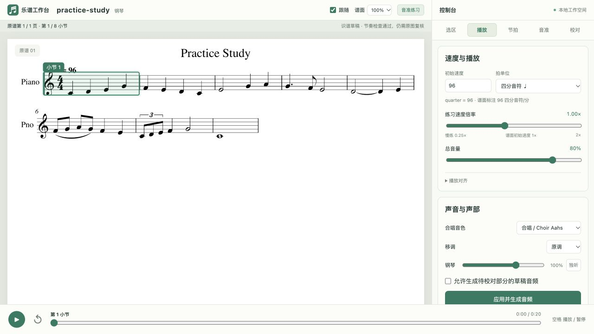

# Choir Assistant · 合唱排练助手

Import a PDF score and produce an interactive rehearsal workbench: synchronized score and audio, selectable notes/regions, part mixing, speed and timbre controls, metronome, source-backed calibration, and experimental sung-pitch feedback.

This repository is a **local-execution Codex plugin and a standalone CLI**. It packages the full recognition → musical structure → whole-score scan → original-page review → correction → rebuilt workbench workflow. Recognition uncertainty remains visible; a playable draft is not a certified transcription.



**v0.4.0** adds optional per-score password access, a private feedback inbox,
source-reviewed lyric overlays, measure numbering and timeline-based score
following. Isolated hosts support incremental staging with an explicit final
administrator activation step. Authoring, hosting, credentials and domain
configuration stay independent. [Deployment workflow](docs/DEPLOYMENT.md)
· [Release notes](docs/RELEASE-v0.4.0.md) ·
[Reusable proofreading contract](docs/SOURCE_REVIEW.md).

## Install the plugin

```sh
codex plugin marketplace add JiamingHu121/choir_assistant
codex plugin add choir-assistant@choir-assistant
```

In the desktop Plugins Directory, select the **Choir Assistant** source and install its plugin. Then ask:

> 用 $choir-workbench 导入这份 PDF 曲谱，完成全谱校准并生成排练工作台。

The package includes a portable root manifest, a Codex compatibility manifest, and a repo marketplace. This GitHub distribution is separate from approval in the public Plugins Directory. The skill needs a host with local files, a terminal, and preferably image/browser tools. See [OpenAI's packaging guide](https://developers.openai.com/plugins/build/plugins).

## Standalone quick start · 命令行快速开始

Install Python 3.12 or later, Audiveris and its Java runtime, FluidSynth, Poppler (`pdftoppm`), and a licensed General MIDI `.sf2` SoundFont. FFmpeg is required by the authoring build for audio fitting and MP3. The standalone website can serve and synthesize WAV without FFmpeg. [Setup and dependency detection](SETUP.md) explain platform-specific installation and environment overrides.

```sh
git clone https://github.com/JiamingHu121/choir_assistant.git
cd choir_assistant
python3 scripts/bootstrap.py --venv /absolute/writable/choir-runtime
export CHOIR_ASSISTANT_SOUNDFONT=/absolute/path/GeneralMIDI.sf2
/absolute/writable/choir-runtime/bin/python scripts/doctor.py --json
/absolute/writable/choir-runtime/bin/choir-assistant import examples/practice-study.pdf --output /absolute/writable/score-run
```

Use the printed workbench URL. The included eight-bar [Practice Study PDF](examples/practice-study.pdf) and [MusicXML source](examples/practice-study.musicxml) are original synthetic fixtures; replace the PDF path with your own score afterward. Each score gets an independent run; PDF, recognition cache, evidence, corrections, and generated audio stay outside the installed plugin. On Windows the venv executables are under `Scripts`; native Windows has not been validated in this release.

导入后会识谱、生成音符结构、扫描全谱并生成工作台。若声部标签不清楚，程序保留识谱结果并给出映射模板；明确映射后续跑。Codex skill 会继续读原谱、校对并批量重建，而单独执行 CLI 不会凭空代替 agent 审读。未解决的识谱问题仍显示为草稿。

## Continue a score

| Command | Purpose |
| --- | --- |
| `import score.pdf --output run-dir` | Preserve PDF, recognize, build, scan, and open the workbench |
| `run --project run-dir/project.json` | Resume a project; add `--part-map mapping.json` when needed |
| `scan --project project.json` | Create a whole-score calibration/evidence run |
| `scan --project project.json --source-review findings.json` | Freeze original-page-confirmed findings for batch correction |
| `apply --run calibration-run --accept-source-reviewed --project project.json` | Accept only source-verified edits and rebuild |
| `apply --run calibration-run --review decisions.json --project project.json` | Apply explicit accept/reject/uncertain decisions |
| `rebuild --project project.json` | Rebuild from the current source and correction ledger |
| `verify --project project.json --output check.json` | Independently check the frozen XML/model and artifact integrity |
| `verify --bundle bundle-dir --facts source-facts.json --output check.json` | Compare original-score facts bound to the final revision and hashes |
| `serve --project project.json` | Open the latest validated bundle in a loopback workbench |
| `status --project project.json` | Show project progress, bundle, and open issues |

The workbench has left/right panels and switchable selection, playback, beat, pitch, and review controls. Click or box-select notes to audition a passage. The original PDF remains available for comparison. The pitch panel shows target spectra, recorded/live pitch deviation, and an experimental mode for singing one part against other background parts.

## Optional shared library website

After reviewing a project, register it in a writable library and synchronize to
an independently configured host:

```sh
choir-assistant library add --library /absolute/score-library \
  --project /absolute/score-run/project.json --id new-score
choir-assistant site sync --profile /absolute/private/site-profile.json
```

The destination is configured once. Subsequent syncs verify the current library
and transfer changed files. A user-service destination activates an immutable
release and restores the previous release on failed validation. A separately
administered service-account destination stages a complete release and reports
`pendingAdminActivation`; its administrator performs the final activation.
`site export` works offline, and the exported site runs without the authoring plugin. No production domain,
account, key or score is bundled. See [setup, profile, rollback and security
boundaries](docs/DEPLOYMENT.md).

Site branding, per-score password access and a private feedback inbox are optional
runtime settings. Generate a private `site-config.json` with an interactive
password prompt, then start the exported server with `--site-config`. For example,
`--site-title "Example Choir Library" --github-url https://github.com/example/project`
sets the visible title and project link. Homepage metadata stays public; protected
scores and downloads require a separate session for each work. Configuration,
credentials and feedback stay outside the export and repository. See the
[private website settings](docs/DEPLOYMENT.md#private-website-settings-per-score-access-and-feedback).

## Accuracy and data

Every note retains its pitch, rational duration, written notation, staff/voice, chord position, and connection relationships. Meter/lane completeness, cross-part timing, and notation contradictions identify review candidates. A beat-fitting solution is not enough evidence to change music. Accepted edits bind source hashes, old values, original image evidence, and a frozen revision; SVG, MIDI, audio, and pitch targets are rebuilt together.

Version 0.2 preserves uncertainty in unsupported extra-symbol removal, ambiguous octave/grace boundaries, mixed-meter relations, and repeat/ending routes. Repairs beyond the field ledger can use an explicitly traced source retranscription; complete beat totals do not establish source accuracy. Singing feedback and background-interference handling need real device validation. See [workflow and limits](docs/WORKFLOW.md). Structural checks and passed tests do not measure whole-score OMR accuracy.

The bundled pipeline runs recognition and synthesis locally. Microphone samples are processed by the browser. If Codex or another hosted agent reviews score images, those images are handled by that host's model/data policy; the plugin does not add a separate cloud inference service. Only import or share scores and recordings you have permission to use. User PDFs, private recordings, generated run directories, SoundFonts, and engine binaries are not distributed in this repository.

Repository-owned code and instructions use the [MIT license](LICENSE); external engines and libraries retain their own licenses. See [third-party components](THIRD_PARTY.md) and [plugin package validation](docs/VALIDATION.md).
