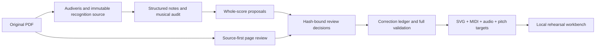

# PDF to rehearsal workbench

The CLI performs recognition, structured-score construction, engraving, synthesis, and whole-score scanning. The packaged `choir-workbench` skill adds original-page review and drives accepted corrections through the same pipeline. The skill uses its host's agent capabilities; the CLI does not contain a second hidden model or require an API key.



## Project state and isolation

Create a writable output directory outside the installed plugin:

```sh
choir-assistant import /absolute/score.pdf --output /writable/score-run --no-open
choir-assistant status --project /writable/score-run/project.json
```

`project.json` holds workflow configuration. `run-state.json` identifies progress and the latest successful bundle/scan. `inputs/` preserves the original PDF and exported MusicXML/OMR. `bundles/` holds independent, hashed build packages. `preview/` holds source renders, selected-passage audio, calibration runs, and the current preview pointer. Runtime/cache directories are external as well; installing the plugin does not import anyone's private scores.

Unknown source part names produce `source-inspection.json` and `part-map.template.json`. Inspect staff names and source IDs, fill the mapping, and resume:

```sh
choir-assistant run --project /writable/score-run/project.json --part-map /absolute/mapping.json
```

The map is a JSON object from source part IDs to `S`, `A`, `T`, `B`, or `Piano`. Exact recognized labels can be mapped automatically; generic Voice 1/2 require explicit mapping. A PDF exporting several distinct scores needs an inspected, zero-based `--score-index`. Do not select the first export merely to bypass ambiguity.

## What the structured score means

Stable source IDs connect notes/rests to original notation, PDF/OMR coordinates, canonical MusicXML, SVG elements, and performance events. A symbol stores pitch, rational performed duration, written type/dots/time-modification, staff/voice, chord membership, and tie/slur/tuplet relationships. Ties sustain a pitch; phrase slurs do not stretch time. Pixel distance and arc length never determine a note's duration.

Whole-score checks compare written and performed duration, beam/flag/dot graph evidence, tuplet ratios, endpoint relationships, voice-lane coverage, and meter constraints. They account for chord simultaneity, pickups, sparse voices, and explicit gaps. Coupled hypotheses preserve all affected symbols. A unique combination that fills the bar is still a hypothesis: it may hide a missing note, false rest, or legitimate independent meter.

Tempo evidence distinguishes explicit metronome marks and their beat unit, MusicXML quarter-note tempo, text-only estimates, and fallback playback values. Numeric conflicts and unresolved relative marks stay visible. Metronome and playback share the canonical tempo timeline. An inferred initial tempo is editable and labeled as inferred.

## Source-first review

Every scan writes a new frozen directory containing `run.json`, `plan.json`, `model-before.json`, the old correction ledger, configuration, source hashes, and `evidence/`. The evidence packet contains original page renders, measure/staff/system crops when reliably located, an HTML viewer, `source-review-queue.json`, and `decisions.template.json`.

Read original images with the source-blind queue first. Transcribe the questioned passage before seeing candidate replacements. Review all flagged measures, then cover the rest of the queue to notice errors the rules cannot detect. Report coverage and uncertain symbols; never replace coverage with a count of generated candidates. Source geometry that cannot be joined reliably stays unlocated, rather than receiving invented crop coordinates.

Save the reader's coverage separately as `review-coverage.json` in the project
directory, including the PDF hash, reviewer, reviewed measure indices, uncertain
symbols, and notes about pitches/relationships that were checked. This record
also covers unchanged measures, which do not produce correction candidates.
Version 0.1 does not automatically turn that report into a certified whole-score
status: the UI continues to show draft/unreviewed provenance after source review.
Report the actual reading coverage alongside the remaining issues.

For difficult passages, another agent can independently read the original source. Give it page/system context, stable symbol IDs, the source-blind queue, and an explicit request for written pitches, rhythm, voice/staff alignment, relationships, and uncertainty. Compare its transcription with the plan afterward. Harmony and repeated passages can prioritize a question, but cannot serve as sole evidence for correcting a note.

### Import source-confirmed findings

Create a JSON record from the frozen model and real original-PDF crop. This example illustrates the shape; replace IDs, hashes, old values, crop, and musical findings with the actual source evidence:

```json
{
  "schemaVersion": 1,
  "sourceSha256": "MusicXML-content-SHA256-from-model-provenance",
  "sourcePdfSha256": "original-PDF-file-SHA256",
  "reviewer": "source-reader",
  "fields": {
    "n-Singer-m12-o2": {
      "sourceSha256": "MusicXML-content-SHA256-from-model-provenance",
      "sourcePdfSha256": "original-PDF-file-SHA256",
      "status": "source-verified",
      "beforeDuration": 0.5,
      "duration": 1,
      "notation": {"type": "quarter", "dots": 0, "timeModification": null},
      "reference": {
        "path": "/absolute/frozen-run/evidence/actual-original-crop.png",
        "sha256": "crop-file-SHA256",
        "sourceSha256": "original-PDF-file-SHA256",
        "source": "original-pdf"
      },
      "reason": "The original shows a filled notehead with stem and no beam/flag or dot."
    }
  }
}
```

Duration is expressed in quarter-note units. A supplied `notation` object must contain **exactly three required fields: `type`, `dots`, and `timeModification`**, and must exactly represent the symbol's performed duration. For an ordinary note, use `"timeModification": null`; omitting this key is invalid. A tuplet note supplies an object with integer `actualNotes` and `normalNotes` instead. For example, an undotted eighth in a 2:3 duplet is `{"type":"eighth","dots":0,"timeModification":{"actualNotes":2,"normalNotes":3}}` and lasts `0.75` quarter-note units. Tuplet display endpoints and their actual/normal counts are separate from the sounding ratio. Save every affected endpoint/symbol in a coupled correction. Pitch and connection changes require their own source evidence; rhythm review does not certify them.

The finding interface supports source-confirmed pitch, duration, notation, tuplet, articulation, tie, and slur fields supported by the correction model. Omitted fields remain unchanged. False-object exclusion, arbitrary note insertion, and octave-direction/repeat-route editing are not supported by this batch finding interface in v0.1.

The following are field fragments to place inside an existing `fields[symbolId]` record, alongside its source hashes, status, reference, and reason:

| Field | Minimal shape and meaning |
| --- | --- |
| `pitch` | `"pitch": 63` changes an already pitched note to integer MIDI pitch 63; allowed range is 0–127. It cannot turn a rest into a note. |
| `tieTypes` | `"tieTypes": ["start"]` opens a sustaining tie; the matching same-pitch note uses `["stop"]`. A continuing tied note may use `["stop", "start"]`. `[]` removes this note's tie endpoints. |
| `slurs` | `"slurs": [{"type":"start","number":"1"}]` opens phrase slur 1; the corresponding endpoint uses `"stop"`. Each endpoint has exactly `type` and `number`; types are `start`, `stop`, or `continue`, and number is a string from `"1"` to `"16"`. |
| `tuplets` | `"tuplets": [{"type":"start","number":"1","actualNumber":2,"normalNumber":3}]` opens displayed tuplet 1; its endpoint uses `{"type":"stop","number":"1"}`. Pair this with each affected note's complete sounding `notation` and duration. |
| `articulations` | `"articulations": ["staccato"]` supplies the full replacement list; `[]` removes false marks. Use only supported MusicXML articulation names. |

Relationship lists replace the symbol's entire existing list. Preserve every independently confirmed endpoint on that symbol and include both ends of any changed relation. `pitchName` is supported by the underlying correction ledger but is **not a source-findings field in v0.1**; this batch interface accepts numeric `pitch` and uses the model's spelling rules. The exact accepted finding fields are `EVIDENCE_FIELDS` in [calibration.py](../workbench/calibration.py); setters and their validation contracts (`_set_reviewed_notation`, `_set_ties`, `_set_slurs`, `_clear_tuplets`, `_set_articulations`, `_set_pitch`) are in [score_model.py](../workbench/score_model.py).

### Original-page evidence when geometry is unavailable

When OMR geometry is absent or a symbol cannot be located reliably, a concrete source-verified finding can use the original PDF or an exact full-page render from the frozen evidence packet. Its reference must add an explicit **1-based integer `page`**. For the original PDF, the reference is:

```json
{
  "path": "/absolute/score-run/inputs/original.pdf",
  "sha256": "original-PDF-file-SHA256",
  "sourceSha256": "original-PDF-file-SHA256",
  "source": "original-pdf",
  "page": 2
}
```

For a complete rendered page, use its actual image path and image `sha256` from `evidence/packet.json`; `sourceSha256` still names the original PDF hash and `page` names that packet's page. A partial crop or an arbitrary file claiming the PDF identity cannot satisfy this fallback. The referenced file, PDF, page number, frozen packet, source MusicXML, and concrete source-verified candidate must all pass hash/identity checks. The accepted decision then binds the new run's complete original-page render to the reviewed symbols, while leaving their geometry unlocated.

Only findings marked `source-verified` that produce concrete `source-verified / auto-eligible` edits can use this page-to-symbol association. Merely having an original page available does not upgrade structural or beat-fitting candidates to verified corrections. The implementation contract is `_confirmed_source_page` and `source_review_decisions` in [calibrate.py](../workbench/calibrate.py).

```sh
choir-assistant scan --project /writable/score-run/project.json --source-review /absolute/findings.json
choir-assistant apply --run /absolute/new-frozen-run --accept-source-reviewed --project /writable/score-run/project.json
```

Use the new run path printed by `scan`. `--accept-source-reviewed` accepts only frozen source-verified concrete edits. Ordinary engine hypotheses stay pending. Alternatively, fill the generated decision template with candidate IDs, accept/reject/uncertain choices, reasons, and bound source evidence, then pass `--review decisions.json`. The review panel exposes the same transaction.

### Acceptance gates

Application checks source/config/ledger/revision/plan identities, unchanged old values, artifact hashes, evidence scope, and conflicting edits. It preserves original source notation and IDs, builds a new ledger/model, and rejects newly introduced structural contradictions even inside previously problematic measures. Accepted edits rebuild all downstream assets in an independent bundle. The project/preview points to the new bundle only after validation; previous runs and bundles remain inspectable.

Changes to local files after a scan make it stale. Start a fresh scan instead of editing the recorded hashes or forcing old decisions. If a field combination fails a gate, inspect the actual source and failure; do not adjust duration solely to pass the test.

## Verify generated outputs

Inspect actual `manifest.json` and bundle `assets/`, not only a status response. Confirm source hashes, active correction provenance, SVG note coverage, canonical/performance events, MIDI versus model timing, WAV duration, clipping, and output hashes. For tuplets, verify actual MEI counts and engraving timing; an engraver's default ratio can otherwise make SVG spacing disagree with correct MIDI. Compare selected repaired and unchanged passages with original pages.

`strict` synthesis rejects structurally blocked selections. `draft` permits explicitly labeled playback of unresolved material. A structurally clean bar can still contain a wrong pitch, false symbol, or incorrect octave direction: neither status certifies original-score accuracy. Keep the original-PDF view available until its relevant details are reviewed.

```sh
choir-assistant serve --project /writable/score-run/project.json
```

The server binds loopback and uses the latest successful project/preview bundle. Verify page loading, source view, note/box selection, part controls, short passage playback, and metronome. Browser pitch practice supports live microphone or uploaded singing and target frequency/spectrum displays. Its antiphonal mode plays selected background parts while assessing another target part; ambiguous unison/shared harmonics or background-dominated frames may be unscored.

## Known limits

Version 0.1 preserves these uncertainties rather than concealing them:

- OMR can add false notes/rests without violating bar completeness. The correction ledger does not yet support removing arbitrary false source objects.
- Written pitch and sounding octave can differ. Octave-direction scopes and nonzero transpositions need source confirmation; some cases are blocked or remain draft, and the SVG must be checked separately.
- Repeats, D.C./D.S./coda, and first/second endings do not form a certified performance route. The workbench currently follows written order.
- Different staff meters and metric-modulation directions need an explicit, verified beat relationship. Stretching every lane to fit one meter is not a calibration.
- Nested tuplets, grace/performance exceptions, poor OMR coordinates, and missing-source symbols can require retranscription rather than a small field correction.
- Microphone/speaker feedback depends on device latency, room noise, leakage, and voice interference. Synthetic fixture tests do not validate real singers or full source separation.

The repository excludes private example scores, recordings, recognized exports, and generated workbench runs. The reusable tests use small constructed score fixtures; an engineering regression pass is not a measured whole-score recognition accuracy.

Notation references: [MusicXML time-modification](https://www.w3.org/2021/06/musicxml40/musicxml-reference/elements/time-modification/), [tuplet](https://www.w3.org/2021/06/musicxml40/musicxml-reference/elements/tuplet/), [metronome](https://www.w3.org/2021/06/musicxml40/musicxml-reference/elements/metronome/), and [sound tempo](https://www.w3.org/2021/06/musicxml40/musicxml-reference/elements/sound/).
